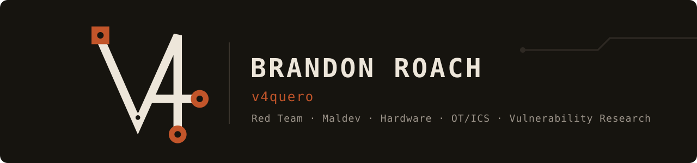

I break the systems companies trust to hold the line, then help them fix it before someone worse finds the gap.

I served in the Marine Corps, then spent six years programming PLCs and SCADA systems before moving to offensive security. Today I lead adversarial operations. I work across the full offensive range, with a primary focus on evasive red teaming, hardware, and OT/ICS.

## What I work on

- Red teaming and adversary simulation
- Malware development: custom C2, initial access, EDR evasion
- Hardware, wireless, and RF
- OT/ICS: PLCs, SCADA, building and access control systems
- Network, cloud, web, Active Directory, and physical

## Research

Published CVEs and CISA ICS advisories.

[CVE-2026-63226](https://www.cve.org/CVERecord?id=CVE-2026-63226) ·
[CVE-2025-25652](https://www.cve.org/CVERecord?id=CVE-2025-25652) ·
[CVE-2022-36633](https://www.cve.org/CVERecord?id=CVE-2022-36633) ·
[CVE-2022-36182](https://www.cve.org/CVERecord?id=CVE-2022-36182) ·
[CVE-2022-29578](https://www.cve.org/CVERecord?id=CVE-2022-29578) ·
[ICSA-22-165-02](https://www.cisa.gov/news-events/ics-advisories/icsa-22-165-02)

## Elsewhere

[LinkedIn](https://www.linkedin.com/in/v4quero/)

USMC veteran · OSCP · DFW, Texas · Opinions are my own.
